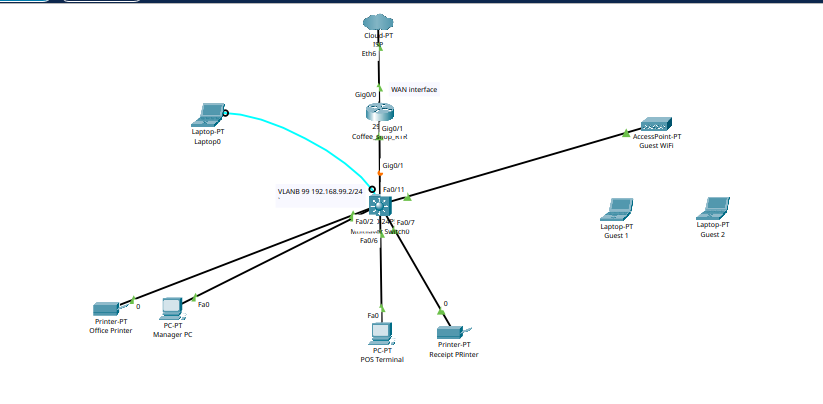

# Coffee Shop Network | Cisco Packet Tracer

A segmented small-business network designed and configured in Cisco Packet Tracer. The goal was to keep the shop's office and point-of-sale systems separate and secure while still offering free guest Wi-Fi to customers.



## Project Summary

The network uses a multilayer switch and a single router in a **router-on-a-stick** design. Traffic is divided into four VLANs, and the router handles all routing between them. Guests can reach the internet but are blocked from the office, POS and management networks by an access list.

**Skills demonstrated:** VLANs, 802.1Q trunking, inter-VLAN routing, DHCP, extended ACLs, SSH, PortFast, Cisco IOS device hardening, network documentation.

## Devices

| Device | Name | Role |
|---|---|---|
| Cloud | ISP | Simulated internet provider |
| Router | CoffeeShop-RTR | WAN connection and inter-VLAN routing |
| Multilayer switch | CoffeeShop-MLS | Core switch for all devices |
| Access point | Guest WiFi | Wireless access for customers |
| PC | Manager PC | Manager workstation |
| Printer | Office Printer | Back-office printing |
| PC | POS Terminal | Point-of-sale computer |
| Printer | Receipt Printer | Customer receipts |
| Laptops | Guest 1, Guest 2 | Customer devices |
| Laptop | Laptop0 | Admin laptop (console connection) |

## Physical Connections

| From | Port | To | Port | Notes |
|---|---|---|---|---|
| ISP Cloud | Eth6 | CoffeeShop-RTR | Gig0/0 | WAN link |
| CoffeeShop-RTR | Gig0/1 | CoffeeShop-MLS | Gig0/1 | 802.1Q trunk |
| CoffeeShop-MLS | Fa0/1 - Fa0/2 | Manager PC, Office Printer | Fa0 / 0 | VLAN 10 |
| CoffeeShop-MLS | Fa0/6 | POS Terminal | Fa0 | VLAN 20 |
| CoffeeShop-MLS | Fa0/7 | Receipt Printer | 0 | VLAN 20 |
| CoffeeShop-MLS | Fa0/11 | Guest WiFi AP | Port 0 | VLAN 30 |
| Laptop0 | RS232 | CoffeeShop-MLS | Console | Configuration only |

## VLAN and IP Plan

| VLAN | Name | Subnet | Gateway | Used by |
|---|---|---|---|---|
| 10 | MANAGEMENT_OFFICE | 192.168.10.0/24 | 192.168.10.1 | Manager PC, Office Printer |
| 20 | POS | 192.168.20.0/24 | 192.168.20.1 | POS Terminal, Receipt Printer |
| 30 | GUEST_WIFI | 192.168.30.0/24 | 192.168.30.1 | Guest AP and customer devices |
| 99 | NETWORK_MANAGEMENT | 192.168.99.0/24 | 192.168.99.1 | Switch management |

The switch is managed at **192.168.99.2/24** with a default gateway of **192.168.99.1**.

## What I Configured

### Switch (CoffeeShop-MLS)
- Hostname, enable secret, password encryption and a login banner
- Console password with synchronous logging
- VLANs 10, 20, 30 and 99
- Access ports: Fa0/1-5 (VLAN 10), Fa0/6-10 (VLAN 20), Fa0/11 (VLAN 30), all with PortFast
- 802.1Q trunk on Gig0/1 allowing only VLANs 10, 20, 30 and 99
- Management SVI on VLAN 99
- SSH version 2 with a local admin account, SSH-only VTY lines and a 10-minute timeout

### Router (CoffeeShop-RTR)
- Hostname, enable secret, password encryption, banner and console protection
- Sub-interfaces Gig0/1.10, .20, .30 and .99 with 802.1Q encapsulation
- DHCP pools for VLANs 10, 20 and 30, with the first 20 addresses of each range excluded for static devices
- Extended ACL **GUEST_RESTRICTIONS** applied inbound on Gig0/1.30

### Guest Isolation (ACL)

Rules are processed top to bottom:

1. Permit DHCP requests from guest devices
2. Deny guest traffic to 192.168.10.0/24 (management office)
3. Deny guest traffic to 192.168.20.0/24 (POS)
4. Deny guest traffic to 192.168.99.0/24 (network management)
5. Permit all other guest traffic (internet access)

## Verification

Commands used to confirm everything worked: `show vlan brief`, `show interface brief`, `show ip interface brief`, `show ip dhcp pool`, `show access-list` and `show running-config`.

## Repository Contents

```
.
├── README.md
├── network_diagram.png            # Topology screenshot
├── coffee-shop-network.pkt        # Packet Tracer file (open with Cisco Packet Tracer)
├── Network_Documentation.pdf      # Full write-up
└── configs/
    ├── CoffeeShop-MLS.txt         # Switch configuration
    └── CoffeeShop-RTR.txt         # Router configuration
```

> **Note:** Passwords in the config files have been replaced with `<password>` placeholders.

## How to Open the Project

1. Install [Cisco Packet Tracer](https://www.netacad.com/) (free with a Cisco Networking Academy account).
2. Download `coffee-shop-network.pkt` from this repository.
3. Open it in Packet Tracer and click through the devices to view the configurations.

## Known Gaps and Future Improvements

- Set real DNS servers in the DHCP pools (currently a 0.0.0.0 placeholder)
- Add an IP address, default route and NAT on the router's WAN interface for full internet access
- Use unique, stronger passwords for the console, enable secret and admin account
- Run and record ping tests between VLANs to prove the ACL behaves as intended

## Author

**Rinchhen Thing** | [LinkedIn](https://www.linkedin.com/in/rinchhen-thing-764814311/) | thingrinchhen@gmail.com
